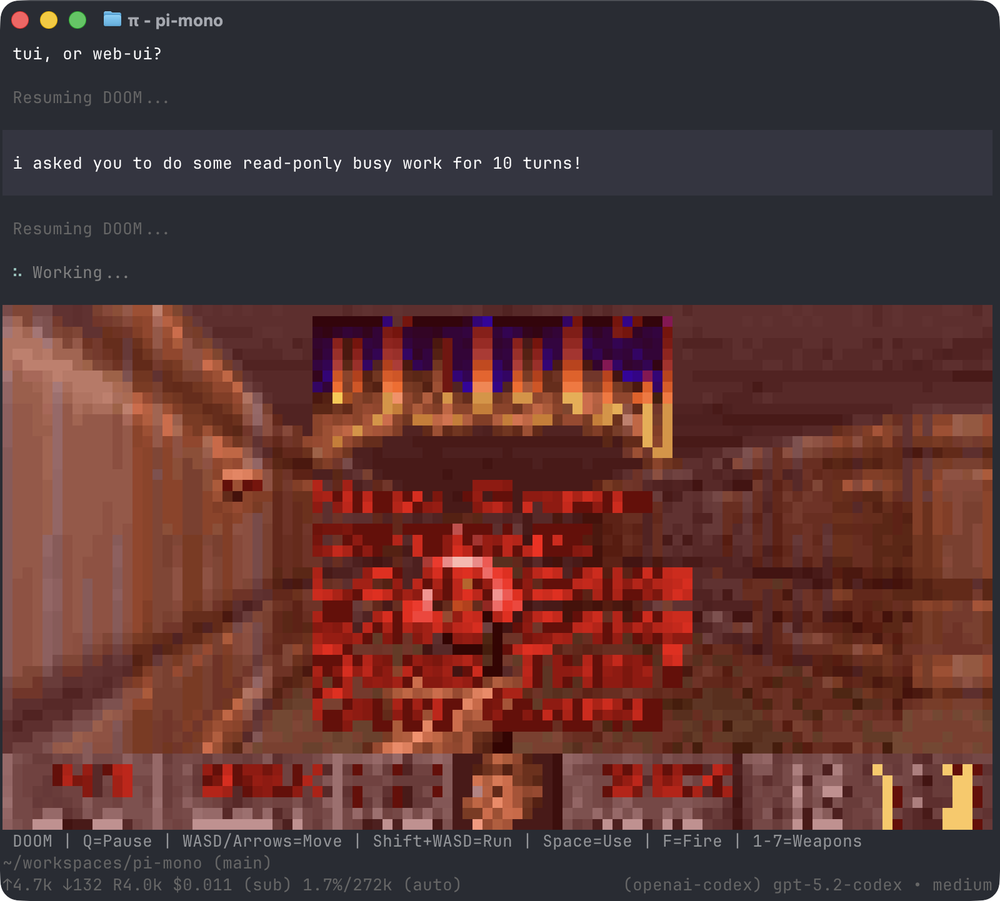

<p align="center">
  <a href="https://www.npmjs.com/package/@step-harness/coding-agent"></a>
</p>

---

`@step-harness/coding-agent` is the StepCode runtime: a minimal terminal coding harness. Adapt it to your workflows, not the other way around, without forking and modifying the internals. Extend it with TypeScript [Extensions](#extensions), [Skills](#skills), [Prompt Templates](#prompt-templates), and [Themes](#themes). Put your extensions, skills, prompt templates, and themes in a [StepCode package](#packages) and share it with others via npm or git.

StepCode ships with powerful defaults but skips opinionated features like sub agents and plan mode. Instead, ask it to build what you want, or install a third-party package that matches your workflow.

StepCode runs in four modes: interactive, print or JSON, RPC for process integration, and an SDK for embedding in your own apps.

### Upstream lineage and naming

The shipped entrypoint is `step`, and its config and package root is `~/.stepcode/`. This runtime is derived from an upstream project whose CLI carried a different name, which survives in three identifiers that are compatibility contracts rather than branding, and that are therefore documented as-is below:

- the `pi` manifest key the package loader reads from `package.json`
- the `pi-package` npm keyword used for package discovery
- the published `@step-harness/pi-tui` component package

Telemetry span and attribute names keep the same legacy prefix; see [telemetry-schema.md](../agent-core/docs/telemetry-schema.md).

## Table of Contents

- [Quick Start](#quick-start)
- [Providers & Models](#providers--models)
- [Interactive Mode](#interactive-mode)
  - [Editor](#editor)
  - [Commands](#commands)
  - [Keyboard Shortcuts](#keyboard-shortcuts)
  - [Message Queue](#message-queue)
- [Sessions](#sessions)
  - [Branching](#branching)
  - [Compaction](#compaction)
- [Settings](#settings)
- [Context Files](#context-files)
- [Customization](#customization)
  - [Prompt Templates](#prompt-templates)
  - [Skills](#skills)
  - [Extensions](#extensions)
  - [Themes](#themes)
  - [Packages](#packages)
- [Programmatic Usage](#programmatic-usage)
- [Philosophy](#philosophy)
- [CLI Reference](#cli-reference)

---

## Quick Start

```bash
npm install -g --ignore-scripts @step-harness/coding-agent
```

`--ignore-scripts` disables dependency lifecycle scripts during install. StepCode does not require install scripts for normal npm installs.

Authenticate with an API key:

```bash
export STEP_API_KEY=...
step
```

Or use your existing subscription:

```bash
step
/login  # Then select provider
```

Then just talk to StepCode. By default, it gives the model four tools: `read`, `write`, `edit`, and `bash`. The model uses these to fulfill your requests. Add capabilities via [skills](#skills), [prompt templates](#prompt-templates), [extensions](#extensions), or [packages](#packages).

**Platform notes:** [Windows](docs/windows.md) | [Termux (Android)](docs/termux.md) | [tmux](docs/tmux.md) | [Terminal setup](docs/terminal-setup.md) | [Shell aliases](docs/shell-aliases.md)

---

## Providers & Models

The shipped build authenticates against the **Step provider** by default. Log in with `/login` (or set `STEP_API_KEY`), then select a Step model via `/model` (or Ctrl+L). Press Ctrl+S in the model picker to save the highlighted model as the startup default.

No other provider catalog is bundled. Add OpenAI- or Anthropic-compatible providers yourself via `~/.stepcode/agent/models.json`; configured catalogs refresh automatically, and `step update --models` forces an immediate refresh. For custom APIs or OAuth, use extensions.

StepCode also supports the llama.cpp router server. Configure it with `/login llama.cpp`, manage downloads and loaded models with `/llama`, then select a loaded model with `/model`. See [docs/llama-cpp.md](docs/llama-cpp.md) for setup and usage.

**Custom providers & models:** Add providers via `~/.stepcode/agent/models.json` if they speak a supported API (OpenAI or Anthropic). See [docs/models.md](docs/models.md) and [docs/custom-provider.md](docs/custom-provider.md), or [@step-harness/providers](../providers/README.md) for the underlying protocols.

---

## Interactive Mode

<p align="center"></p>

The interface from top to bottom:

- **Startup header** - Shows shortcuts (`/hotkeys` for all), loaded AGENTS.md files, prompt templates, skills, and extensions
- **Messages** - Your messages, assistant responses, tool calls and results, notifications, errors, and extension UI
- **Editor** - Where you type; border color indicates thinking level
- **Footer** - Working directory, session name, total token/cache usage (`↑` input, `↓` output, `R` cache read, `W` cache write, `CH` latest cache hit rate), cost, context usage, current model. Totals include assistant responses, usage reported by tools, and summary generation.

The editor can be temporarily replaced by other UI, like built-in `/settings` or custom UI from extensions (e.g., a Q&A tool that lets the user answer model questions in a structured format). [Extensions](#extensions) can also replace the editor, add widgets above/below it, a status line, custom footer, or overlays.

### Editor

| Feature | How |
|---------|-----|
| File reference | Type `@` to fuzzy-search project files |
| Path completion | Tab to complete paths |
| Multi-line | Shift+Enter, Alt+Enter, or Ctrl+J (Ctrl+Enter also works on Windows Terminal) |
| External editor | Ctrl+G opens `externalEditor`, `$VISUAL`, `$EDITOR`, Notepad on Windows, or `nano` elsewhere |
| Clipboard | Ctrl+V to paste an image or text (Alt+V on Windows), or drag images onto terminal |
| Bash commands | `!command` runs and sends output to LLM, `!!command` runs without sending |

Standard editing keybindings for delete word, undo, etc. See [docs/keybindings.md](docs/keybindings.md).

### Commands

Type `/` in the editor to trigger commands. [Extensions](#extensions) can register custom commands, [skills](#skills) are available as `/skill:name`, and [prompt templates](#prompt-templates) expand via `/templatename`.

| Command | Description |
|---------|-------------|
| `/login`, `/logout` | Manage provider credentials |
| [`/llama`](docs/llama-cpp.md) | Download, load, and unload llama.cpp router models |
| `/model` | Switch models; Ctrl+S in the picker saves the startup default |
| `/effort` | Switch thinking level and save it as the startup default |
| `/scoped-models` | Enable/disable models for Ctrl+P cycling |
| `/settings` | Theme, message delivery, transport, and other preferences |
| `/resume` | Pick from previous sessions |
| `/new` | Start a new session |
| `/name <name>` | Set session display name |
| `/session` | Show session info (file, ID, messages, tokens, cost) |
| `/tree` | Jump to any point in the session and continue from there |
| `/trust` | Save project trust decision for future sessions (restart required) |
| `/fork` | Create a new session from a previous user message |
| `/clone` | Duplicate the current active branch into a new session |
| `/compact [prompt]` | Manually compact context, optional custom instructions |
| `/copy` | Copy last assistant message to clipboard |
| `/export [file]` | Export session to HTML or JSONL file |
| `/import <file>` | Import and resume a session from a JSONL file |
| `/share` | Upload as private GitHub gist with shareable HTML link |
| `/reload` | Reload keybindings, extensions, skills, prompts, themes, and context files |
| `/hotkeys` | Show all keyboard shortcuts |
| `/quit` | Quit step |

### Keyboard Shortcuts

See `/hotkeys` for the full list. Customize via `~/.stepcode/agent/keybindings.json`. See [docs/keybindings.md](docs/keybindings.md).

**Commonly used:**

| Key | Action |
|-----|--------|
| Ctrl+C | Clear editor |
| Ctrl+C twice | Quit |
| Escape | Cancel/abort |
| Escape twice | Open `/tree` |
| Ctrl+L | Open model selector |
| Ctrl+P / Shift+Ctrl+P | Cycle scoped models forward/backward |
| Shift+Tab | Cycle thinking level |
| Ctrl+O | Collapse/expand tool output |
| Ctrl+T | Collapse/expand thinking blocks |
| Ctrl+X | Copy the last assistant message; with fullscreen copy-on-select disabled, copy the active text selection |

### Message Queue

Submit messages while the agent is working:

- **Enter** queues a *steering* message, delivered after the current assistant turn finishes executing its tool calls
- **Escape** aborts and restores queued messages to editor
- **Alt+Up** retrieves queued messages back to editor

Follow-up delivery remains available to extensions, RPC clients, and custom `app.message.followUp` keybindings, but has no default shortcut.

On Windows Terminal, `Alt+Enter` is fullscreen by default. Remap it in [docs/terminal-setup.md](docs/terminal-setup.md) so step can receive the newline shortcut.

Configure delivery in [settings](docs/settings.md): `steeringMode` and `followUpMode` can be `"one-at-a-time"` (default, waits for response) or `"all"` (delivers all queued at once). `transport` selects provider transport preference (`"sse"`, `"websocket"`, or `"auto"`) for providers that support multiple transports.

---

## Sessions

Sessions are stored as JSONL files with a tree structure. Each entry has an `id` and `parentId`, enabling in-place branching without creating new files. See [docs/session-format.md](docs/session-format.md) for file format.

### Management

Sessions auto-save to `~/.stepcode/agent/sessions/` organized by working directory.

```bash
step -c                  # Continue most recent session
step -r                  # Browse and select from past sessions
step --no-session        # Ephemeral mode (don't save)
step --name "my task"    # Set session display name at startup
step --session <path|id> # Use specific session file or ID
step --fork <path|id>    # Fork specific session file or ID into a new session
```

Use `/session` in interactive mode to see the current session ID before reusing it with `--session <id>` or `--fork <id>`.

### Branching

**`/tree`** - Navigate the session tree in-place. Select any previous point, continue from there, and switch between branches. All history preserved in a single file.

<p align="center"></p>

- Search by typing, fold/unfold and jump between branches with Ctrl+←/Ctrl+→ or Alt+←/Alt+→, page with ←/→
- Filter modes (Ctrl+O): default → no-tools → user-only → labeled-only → all
- Press Ctrl+X to copy the selected message
- Press Shift+L to label entries as bookmarks and Shift+T to toggle label timestamps

**`/fork`** - Create a new session file from a previous user message on the active branch. Opens a selector, copies the active path up to that point, and places the selected prompt in the editor for modification.

**`/clone`** - Duplicate the current active branch into a new session file at the current position. The new session keeps the full active-path history and opens with an empty editor.

**`--fork <path|id>`** - Fork an existing session file or partial session UUID directly from the CLI. This copies the full source session into a new session file in the current project.

### Compaction

Long sessions can exhaust context windows. Compaction summarizes older messages while keeping recent ones.

**Manual:** `/compact` or `/compact <custom instructions>`

**Automatic:** Enabled by default. Triggers on context overflow (recovers and retries) or when approaching the limit (proactive). Configure via `/settings` or `settings.json`.

Compaction is lossy. The full history remains in the JSONL file; use `/tree` to revisit. Customize compaction behavior via [extensions](#extensions). See [docs/compaction.md](docs/compaction.md) for internals.

---

## Settings

Use `/settings` to modify common options, or edit JSON files directly:

| Location | Scope |
|----------|-------|
| `~/.stepcode/agent/settings.json` | Global (all projects) |
| `.stepcode/settings.json` | Project (overrides global) |

See [docs/settings.md](docs/settings.md) for all options.

### Project Trust

On interactive startup, step asks before trusting a project folder that contains project-local settings, resources, or project `.agents/skills` or `.claude/skills` and has no saved decision for the folder or a parent folder in `~/.stepcode/agent/trust.json`. Trusting a project allows step to load `.stepcode/settings.json` and `.stepcode` resources, install missing project packages, and execute project extensions.

Before the trust decision, step loads only context files, user/global extensions, and CLI `-e` extensions so they can handle the `project_trust` event. Project-local extensions, project package-managed extensions, and project settings are loaded only after the project is trusted. This split also applies when switching to a session from a different cwd whose trust has not been resolved in the current process.

Non-interactive modes (`-p`, `--mode json`, and `--mode rpc`) do not show a trust prompt. Without an applicable saved trust decision, they use `defaultProjectTrust` from global settings: `ask` (default) and `never` ignore those project resources, while `always` trusts them. Pass `--approve`/`-a` or `--no-approve`/`-na` to override project trust for one run.

If no extension or saved decision applies, `defaultProjectTrust` controls the fallback behavior. Set it to `"ask"`, `"always"`, or `"never"` in `~/.stepcode/agent/settings.json`, or change it with `/settings`.

`step config` and package commands use the same project trust flow, except `step update` never prompts. Pass `--approve` to trust project-local settings for one command or `--no-approve` to ignore them.

Use `/trust` in interactive mode to save a project trust decision for future sessions, including trust for the immediate parent folder. It writes `~/.stepcode/agent/trust.json` only; the current session is not reloaded, so restart step for changes to take effect.

---

## Context Files

StepCode loads `AGENTS.md` (or `CLAUDE.md`) at startup from:
- `~/.stepcode/agent/AGENTS.md` (global)
- Parent directories (walking up from cwd)
- Current directory

If a directory contains `AGENTS.override.md`, StepCode loads it instead of `AGENTS.md` or `CLAUDE.md` from that directory. Context files from other directories are still concatenated.

Use for project instructions (`AGENTS.md`/`CLAUDE.md`), conventions, common commands. All matching files are concatenated.

Disable context file loading with `--no-context-files` (or `-nc`).

### System Prompt

Replace the default system prompt with `.stepcode/SYSTEM.md` (project) or `~/.stepcode/agent/SYSTEM.md` (global). Append without replacing via `APPEND_SYSTEM.md`.

---

## Customization

### Prompt Templates

Reusable prompts as Markdown files. Type `/name` to expand.

```markdown
<!-- ~/.stepcode/agent/prompts/review.md -->
Review this code for bugs, security issues, and performance problems.
Focus on: {{focus}}
```

Place in `~/.stepcode/agent/prompts/`, `.stepcode/prompts/`, or a [package](#packages) to share with others. See [docs/prompt-templates.md](docs/prompt-templates.md).

### Skills

On-demand capability packages following the [Agent Skills standard](https://agentskills.io). Invoke via `/skill:name` or let the agent load them automatically.

```markdown
<!-- ~/.stepcode/agent/skills/my-skill/SKILL.md -->
# My Skill
Use this skill when the user asks about X.

## Steps
1. Do this
2. Then that
```

Place in `~/.stepcode/agent/skills/`, `~/.stepcode/skills/`, `~/.agents/skills/`, `~/.claude/skills/`, `.stepcode/skills/`, `.agents/skills/`, or `.claude/skills/` (the last two from `cwd` up through parent directories) or a [package](#packages) to share with others. See [docs/skills.md](docs/skills.md).

### Extensions

<p align="center"></p>

TypeScript modules that extend step with custom tools, commands, keyboard shortcuts, event handlers, and UI components.

```typescript
export default function (pi: ExtensionAPI) {
  pi.registerTool({ name: "deploy", ... });
  pi.registerCommand("stats", { ... });
  pi.on("tool_call", async (event, ctx) => { ... });
}
```

The default export can also be `async`. step waits for async extension factories before startup continues, which is useful for one-time initialization such as fetching remote model lists before calling `pi.registerProvider()`.

**What's possible:**
- Custom tools (or replace built-in tools entirely)
- Sub-agents and plan mode
- Custom compaction and summarization
- Permission gates and path protection
- Custom editors and UI components
- Status lines, headers, footers
- Git checkpointing and auto-commit
- SSH and sandbox execution
- MCP server integration
- Make step look like Claude Code
- Games while waiting (yes, Doom runs)
- ...anything you can dream up

Place in `~/.stepcode/agent/extensions/`, `.stepcode/extensions/`, or a [package](#packages) to share with others. See [docs/extensions.md](docs/extensions.md) and [examples/extensions/](examples/extensions/).

### Themes

Built-in: `dark`, `light`, `sage`, `step-blue`, `step-violet`, `step-violet-light`. Themes hot-reload: modify the active theme file and step immediately applies changes.

Place in `~/.stepcode/agent/themes/`, `.stepcode/themes/`, or a [package](#packages) to share with others. See [docs/themes.md](docs/themes.md).

### Step entrypoint

The `step` binary selects the `step` provider and model by default, uses the
built-in `step-blue` theme (one blue palette, no light/dark variants), and
stores sessions under `~/.stepcode/`.

```bash
STEP_API_KEY=... step
step --help
```

Step-specific behavior is registered as an extension (`/init`, provider login,
and branding). The editor, input protocol, selectors, overlays, queueing, and
agent lifecycle are owned by the shared runtime.

### Packages

Bundle and share extensions, skills, prompts, and themes via npm or git. Find packages on [npmjs.com](https://www.npmjs.com/search?q=keywords%3Api-package).

> **Security:** StepCode packages run with full system access. Extensions execute arbitrary code, and skills can instruct the model to perform any action including running executables. Review source code before installing third-party packages.

```bash
step install npm:@foo/step-tools
step install npm:@foo/step-tools@1.2.3      # pinned version
step install git:github.com/user/repo
step install git:github.com/user/repo@v1  # tag or commit
step install git:git@github.com:user/repo
step install git:git@github.com:user/repo@v1  # tag or commit
step install https://github.com/user/repo
step install https://github.com/user/repo@v1      # tag or commit
step install ssh://git@github.com/user/repo
step install ssh://git@github.com/user/repo@v1    # tag or commit
step remove npm:@foo/step-tools
step uninstall npm:@foo/step-tools        # alias for remove
step list
step update                             # update StepCode only
step update --all                       # update StepCode and packages
step update --extensions                # update packages only
step update --models                    # refresh model catalogs only
step update --self                      # update StepCode only
step update --self --force              # reinstall StepCode even if current
step update npm:@foo/step-tools           # update one package
step config                             # enable/disable extensions, skills, prompts, themes
```

Packages install to `~/.stepcode/agent/git/` (git) or `~/.stepcode/agent/npm/` (npm). Use `-l` for project-local installs (`.stepcode/git/`, `.stepcode/npm/`). Git `@ref` values are pinned tags or commits; pinned packages are skipped by `step update --extensions` and `step update --all`, so use `step install git:host/user/repo@new-ref` to move an existing package to a new ref. Git packages install dependencies with `npm install --omit=dev` by default, so runtime deps must be listed under `dependencies`; when `npmCommand` is configured, git packages use plain `install` for compatibility with wrappers. If you use a Node version manager and want package installs to reuse a stable npm context, set `npmCommand` in `settings.json`, for example `["mise", "exec", "node@20", "--", "npm"]`.

Create a package by adding a `pi` manifest key to `package.json`. The key keeps its upstream name so already-published packages stay discoverable:

```json
{
  "name": "my-step-package",
  "keywords": ["pi-package"],
  "pi": {
    "extensions": ["./extensions"],
    "skills": ["./skills"],
    "prompts": ["./prompts"],
    "themes": ["./themes"]
  }
}
```

Without a `pi` manifest, StepCode auto-discovers from conventional directories (`extensions/`, `skills/`, `prompts/`, `themes/`).

See [docs/packages.md](docs/packages.md).

---

## Programmatic Usage

### SDK

```typescript
import { createAgentSession, ModelRuntime, SessionManager } from "@step-harness/coding-agent";

const modelRuntime = await ModelRuntime.create();
const { session } = await createAgentSession({
  sessionManager: SessionManager.inMemory(),
  modelRuntime,
});

await session.prompt("What files are in the current directory?");
```

For advanced multi-session runtime replacement, use `createAgentSessionRuntime()` and `AgentSessionRuntime`.

See [docs/sdk.md](docs/sdk.md) and [examples/sdk/](examples/sdk/).

### RPC Mode

For non-Node.js integrations, use RPC mode over stdin/stdout:

```bash
step --mode rpc
```

RPC mode uses strict LF-delimited JSONL framing. Clients must split records on `\n` only. Do not use generic line readers like Node `readline`, which also split on Unicode separators inside JSON payloads.

See [docs/rpc.md](docs/rpc.md) for the protocol.

---

## Philosophy

StepCode is aggressively extensible so it doesn't have to dictate your workflow. Features that other tools bake in can be built with [extensions](#extensions), [skills](#skills), or installed from third-party [packages](#packages). This keeps the core minimal while letting you shape StepCode to fit how you work.

**No MCP.** Build CLI tools with READMEs (see [Skills](#skills)), or build an extension that adds MCP support.

**No sub-agents.** There's many ways to do this. Spawn StepCode instances via tmux, or build your own with [extensions](#extensions), or install a package that does it your way.

**No permission popups.** Run in a container, or build your own confirmation flow with [extensions](#extensions) inline with your environment and security requirements.

**No plan mode.** Write plans to files, or build it with [extensions](#extensions), or install a package.

**No built-in to-dos.** They confuse models. Use a TODO.md file, or build your own with [extensions](#extensions).

**No background bash.** Use tmux. Full observability, direct interaction.

This design is deliberate: the runtime stays small, and anything opinionated is
something you add.

---

## CLI Reference

```bash
step [options] [--] [@files...] [messages...]
```

### Package Commands

```bash
step install <source> [-l]     # Install package, -l for project-local
step remove <source> [-l]      # Remove package
step uninstall <source> [-l]   # Alias for remove
step update [source|self|step] # Update StepCode only, or one package source
step update --all              # Update StepCode and packages
step update --extensions       # Update packages only
step update --models           # Refresh model catalogs only
step update --self             # Update StepCode only
step update --self --force     # Reinstall StepCode even if current
step update --extension <src>  # Update one package
step list                      # List installed packages
step config                    # Enable/disable package resources
```

`step config` and project package commands accept `--approve`/`--no-approve` to trust or ignore project-local settings for one command. `step update` never prompts for project trust.

### Modes

| Flag | Description |
|------|-------------|
| (default) | Interactive mode |
| `-p`, `--print` | Print response and exit |
| `--mode json` | Output all events as JSON lines (see [docs/json.md](docs/json.md)) |
| `--mode rpc` | RPC mode for process integration (see [docs/rpc.md](docs/rpc.md)) |
| `--export <in> [out]` | Export session to HTML |

In print mode, step also reads piped stdin and merges it into the initial prompt:

```bash
cat README.md | step -p "Summarize this text"
```

### Model Options

| Option | Description |
|--------|-------------|
| `--provider <name>` | Provider (anthropic, openai, google, etc.) |
| `--model <pattern>` | Model pattern or ID (supports `provider/id` and optional `:<thinking>`) |
| `--api-key <key>` | API key (overrides env vars) |
| `--thinking <level>` | `off`, `minimal`, `low`, `medium`, `high`, `xhigh`, `max` |
| `--models <patterns>` | Comma-separated patterns for Ctrl+P cycling |
| `--list-models [search]` | List available models |

### Session Options

| Option | Description |
|--------|-------------|
| `-c`, `--continue` | Continue most recent session |
| `-r`, `--resume` | Browse and select session |
| `--session <path\|id>` | Use specific session file or partial UUID |
| `--fork <path\|id>` | Fork specific session file or partial UUID into a new session |
| `--session-dir <dir>` | Custom session storage directory |
| `--no-session` | Ephemeral mode (don't save) |
| `--name <name>`, `-n <name>` | Set session display name at startup |

### Tool Options

| Option | Description |
|--------|-------------|
| `--tools <list>`, `-t <list>` | Allowlist specific tool names across built-in, extension, and custom tools |
| `--exclude-tools <list>`, `-xt <list>` | Disable specific tool names across built-in, extension, and custom tools |
| `--no-builtin-tools`, `-nbt` | Disable built-in tools by default but keep extension/custom tools enabled |
| `--no-tools`, `-nt` | Disable all tools by default |

Available built-in tools: `read`, `bash`, `powershell` (Windows), `edit`, `write`, `grep`, `find`, `ls`

### Resource Options

| Option | Description |
|--------|-------------|
| `-e`, `--extension <source>` | Load extension from path, npm, or git (repeatable) |
| `--no-extensions` | Disable extension discovery |
| `--skill <path>` | Load skill (repeatable) |
| `--no-skills` | Disable skill discovery |
| `--prompt-template <path>` | Load prompt template (repeatable) |
| `--no-prompt-templates` | Disable prompt template discovery |
| `--theme <path>` | Load theme (repeatable) |
| `--no-themes` | Disable theme discovery |
| `--no-context-files`, `-nc` | Disable AGENTS.md and CLAUDE.md context file discovery |

Combine `--no-*` with explicit flags to load exactly what you need, ignoring settings.json (e.g., `--no-extensions -e ./my-ext.ts`).

### Other Options

| Option | Description |
|--------|-------------|
| `--system-prompt <text>` | Replace default prompt (context files and skills still appended) |
| `--append-system-prompt <text>` | Append to system prompt |
| `--tui-mode <mode>` | TUI mode: `regular` (default) or experimental `fullscreen` |
| `--use-theme <name[/name]>` | Set the initial interactive theme for this run without changing settings |
| `--verbose` | Force verbose startup |
| `-a`, `--approve` | Trust project-local files for this run |
| `-na`, `--no-approve` | Ignore project-local files for this run |
| `--` | Stop option parsing; remaining arguments are prompts or `@file` inputs |
| `-h`, `--help` | Show help |
| `-v`, `--version` | Show version |

### File Arguments

Prefix files with `@` to include in the message:

```bash
step @prompt.md "Answer this"
step -p @screenshot.png "What's in this image?"
step @code.ts @test.ts "Review these files"
```

### Examples

```bash
# Interactive with initial prompt
step "List all .ts files in src/"

# Non-interactive
step -p "Summarize this codebase"

# Prompt beginning with a dash
step -p -- "- Summarize these points"

# Non-interactive with piped stdin
cat README.md | step -p "Summarize this text"

# Named one-shot session
step --name "release audit" -p "Audit this repository"

# Different model
step --provider openai --model gpt-4o "Help me refactor"

# Model with provider prefix (no --provider needed)
step --model openai/gpt-4o "Help me refactor"

# Model with thinking level shorthand
step --model sonnet:high "Solve this complex problem"

# Limit model cycling
step --models "claude-*,gpt-4o"

# Read-only mode
step --tools read,grep,find,ls -p "Review the code"

# Disable one extension or built-in tool while keeping the rest available
step --exclude-tools ask_question

# High thinking level
step --thinking high "Solve this complex problem"
```

### Environment Variables

| Variable | Description |
|----------|-------------|
| `AI_AGENT` | Set to `step` by the CLI and RPC entry points so generic tooling can attribute child processes to Step |
| `STEP_CODING_AGENT_DIR` | Override config directory (default: `~/.stepcode/agent`) |
| `STEP_CODING_AGENT_SESSION_DIR` | Override session storage directory (overridden by `--session-dir`) |
| `VISUAL`, `EDITOR` | Fallback external editor for Ctrl+G when `externalEditor` is unset; defaults to Notepad on Windows and `nano` elsewhere |

Shell tools inherit the process environment without injecting session metadata. See [Environment Variables](docs/environment-variables.md) for configuration and custom spawn hooks.

---

## Contributing & Development

See [CONTRIBUTING.md](../../CONTRIBUTING.md) for guidelines and [docs/development.md](docs/development.md) for setup, forking, and debugging.

## License

MIT

## See Also

- [@step-harness/providers](https://www.npmjs.com/package/@step-harness/providers): Core LLM toolkit
- [@step-harness/agent-core](https://www.npmjs.com/package/@step-harness/agent-core): Agent framework
- [@step-harness/pi-tui](https://www.npmjs.com/package/@step-harness/pi-tui): Terminal UI components
