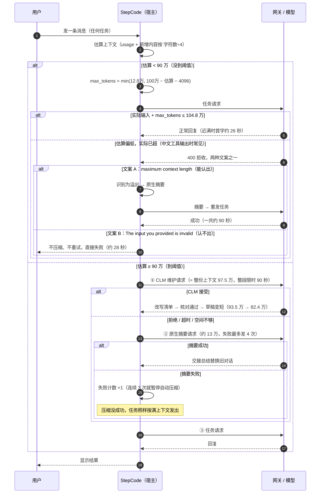
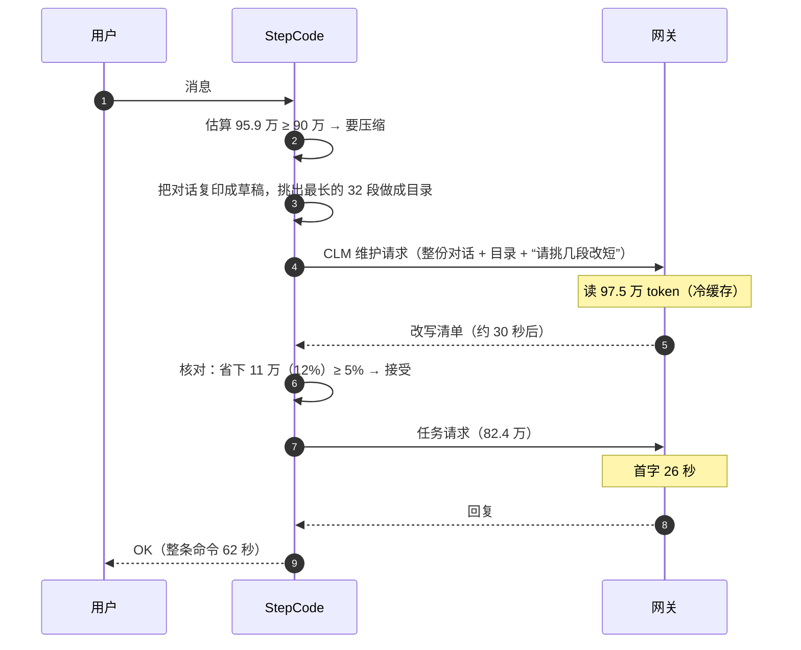
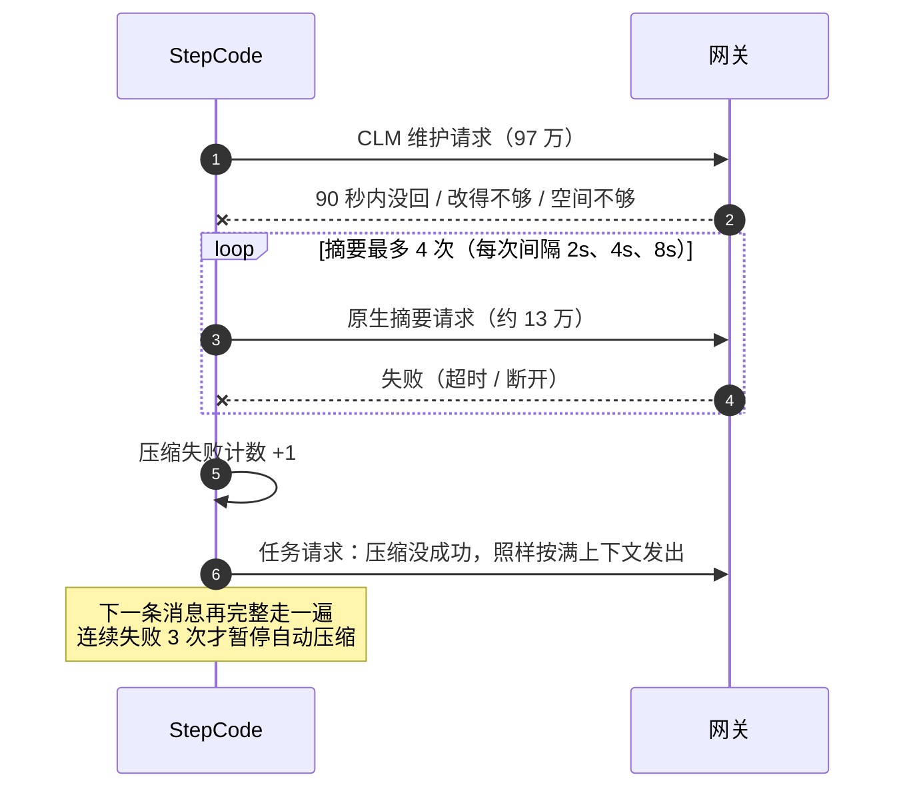
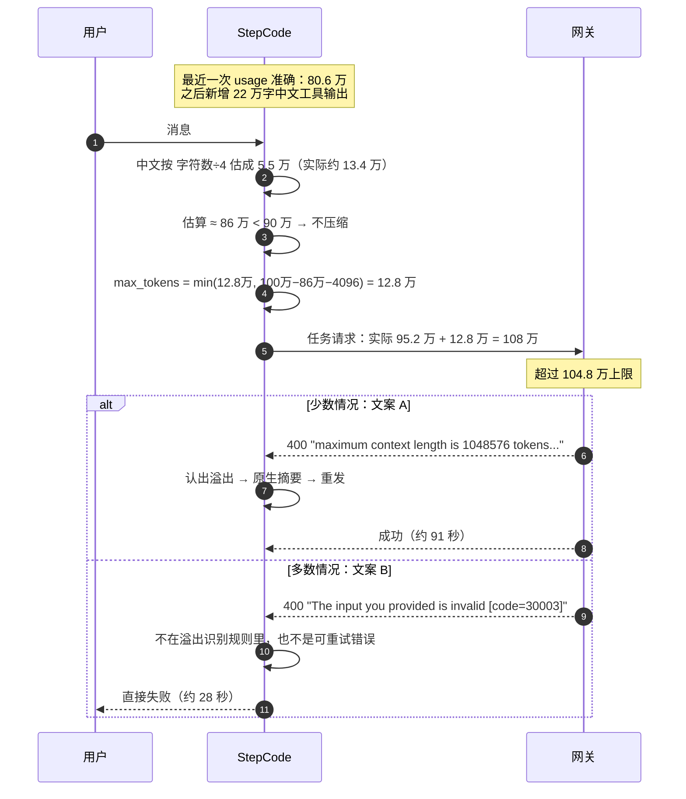
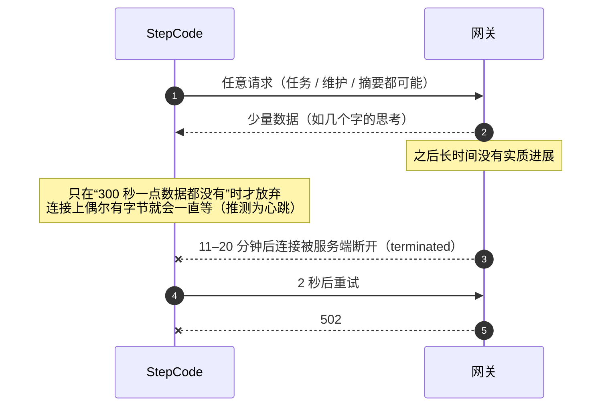
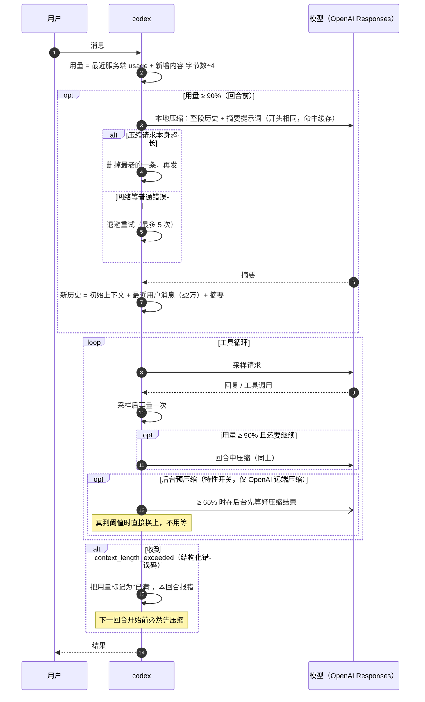
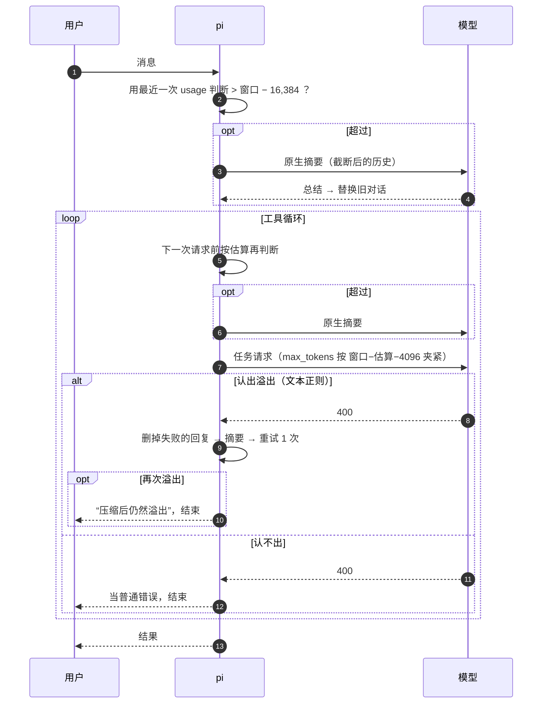
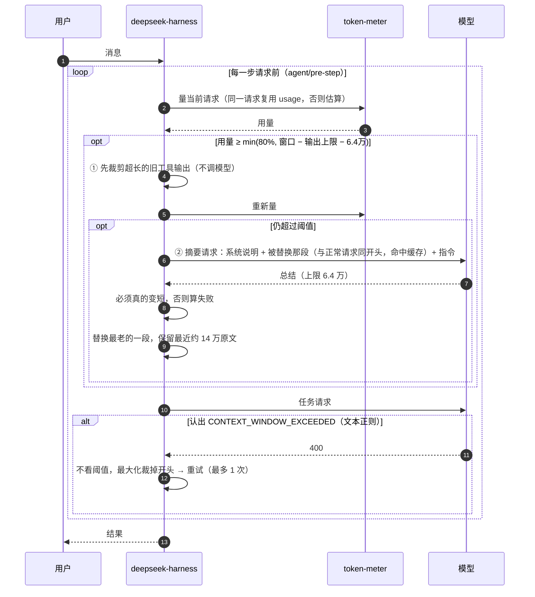

# 近满上下文压缩卡顿：复现、真机压测与四家实现对比

> 适用分支：step-harness `feat/stepcode-desktop-ci-pipeline-build`（commit `c174e430`）
> 模型：`stepcode-anthropic / deepseek-v4.1-flash-api`；配置窗口 1,000,000；网关实际窗口 **1,048,576**；每次请求输出上限 128,000
> 对比对象：`codex`（55897425e8）、`pi`（7d073328e）、`deepseek-harness`（fcc0ad4621）
> 本文是唯一文档。mock 复现、真机压测、日志证据、时序图、四家对比、问题清单都在这里。

## 目录

0. [一页结论](#0-一页结论)
1. [名词释义](#1-名词释义)
2. [step-harness 现在怎么压缩（时序图）](#2-step-harness-现在怎么压缩时序图)
3. [真机压测：慢是真的](#3-真机压测慢是真的)
4. [真机压测：估算偏低 → 被拒收 → 直接失败](#4-真机压测估算偏低--被拒收--直接失败)
5. [日志证据：单个请求挂 20 分钟](#5-日志证据单个请求挂-20-分钟)
6. [mock 复现与稳定性](#6-mock-复现与稳定性)
7. [四家对比：codex / pi / deepseek-harness / step-harness](#7-四家对比codex--pi--deepseek-harness--step-harness)
8. [问题清单与可借鉴的修法](#8-问题清单与可借鉴的修法)
9. [更正记录](#9-更正记录)
10. [怎么复跑](#10-怎么复跑)
11. [修复方案与执行计划](#11-修复方案与执行计划)

---

## 0. 一页结论

用户说“上下文快满时，什么任务都特别慢，二三十分钟不动”。实际是三件事叠在一起：

| # | 现象 | 是否复现 | 说明 |
| --- | --- | --- | --- |
| 1 | **越满越慢** | ✅ 真机稳定复现 | 同一条命令：6 万上下文 5.8 秒，93 万上下文 62 秒；首字延迟 4 秒 → 26 秒。快满时每条消息前面还要先发一个**和整份上下文一样大**的压缩请求（实测 97.5 万 token，约 30 秒）。 |
| 2 | **突然失败、不动了** | ✅ 真机稳定复现 | 末尾有大段中文工具输出时，宿主把 token 少算了 2.45 倍，以为没到阈值，就没压缩；实际请求超出网关上限，被 400 拒收。网关有两种报错文案，**其中一种程序认不出来**：不压缩、不重试，直接结束。真实场景 7 次里 5 次直接失败，**默认的 CLM 模式也会中**。 |
| 3 | **挂二三十分钟** | ❌ 没复现，只有日志证据 | 单个请求在服务端挂住，客户端对单个请求没有总时长上限。本机日志里有 19.5 分钟、11.6 分钟两次。这本身不是压缩引起的，但快满时请求更大、更多，更容易碰上。 |

和其他三家比：
- **codex** 按“字节数 ÷ 4”估算中文，不会少算；溢出靠结构化错误码识别，压缩请求自己溢出时会删掉最老的一条再试。
- **deepseek-harness** 的阈值是 80%，并直接扣掉“输出上限 + 6.4 万余量”；压缩前先裁剪超长工具输出，摘要请求复用前缀缓存。
- **pi**（我们的上游）阈值更靠后（窗口 − 16,384），估算方式和溢出识别跟我们一样，所以同样的坑它也会踩。

---

## 1. 名词释义

| 术语 | 大白话 |
| --- | --- |
| **上下文（context）** | 每次发给模型的全部内容：聊天记录 + 系统说明 + 工具说明。模型每次都要从头读一遍，越长越慢。StepCode 光系统说明加工具定义就有约 **2.8 万 token**。 |
| **token** | 模型计量文字的单位。实测这个模型：英文代码约 3.8 个字符 1 个 token；**中文约 1.6 个字 1 个 token（0.61 token/字）**。 |
| **窗口（context window）** | 一次最多能读多少 token。配置写的是 100 万，网关实际是 104.8 万；而且“输入 + 输出上限”加起来不能超过它。 |
| **宿主（host）** | 我们自己的客户端程序（StepCode），负责拼上下文、决定何时压缩、把请求发给网关。 |
| **网关 / 模型** | 远端服务，真正读上下文、生成回复。 |
| **阈值（threshold）** | “快满了”的判断线。step-harness 是 **90 万**，超过就先压缩再干活。 |
| **估算（estimate）** | 宿主自己算的“现在大概多少 token”。最近一次回复带回的 usage 是准的；之后新增的内容只能粗算：step-harness/pi 用“**字符数 ÷ 4**”，codex 用“**字节数 ÷ 4**”。 |
| **usage** | 网关回复里附带的“这次实际用了多少 token”，最准。 |
| **压缩（compaction）** | 快满时把旧内容变短，给新内容腾地方。 |
| **CLM** | step-harness 默认的压缩方式（文档叫 model-managed working context，模型托管的工作上下文）。宿主把对话复印成一份“草稿”，请模型挑几段过时的长内容改成一句话；原始记录不动，之后发给模型的是改短后的草稿。 |
| **维护请求（maintenance）** | 为 CLM 专门发的一次请求。跟你的任务无关，但**要带着几乎整份上下文**（实测 97.5 万 token）。 |
| **CLM 接受 / 拒绝** | 模型交回改写清单后，宿主核对：只改了允许改的段落、而且至少省下 5%，就接受，草稿生效；否则就拒绝（包括超时、模型没改），改走原生摘要。 |
| **原生摘要（native compaction）** | 老办法：请模型写一份“交接总结”，把旧对话整段替换掉，只保留最近约 2 万 token 原文。工具输出会先截短，所以这个请求比 CLM 小（实测约 13 万）。 |
| **输出上限（max_tokens）** | 每次请求声明“最多让模型写多少”，这里是 12.8 万，也占窗口。provider 层会按“窗口 − 估算输入 − 4096”把它往下压，但用的仍是那个**估算值**。 |
| **溢出（overflow）** | 请求太大，被网关拒收（HTTP 400）。宿主**认得出**就先压缩再重发；**认不出**就当普通错误，直接结束。 |
| **重试（retry）** | 失败后隔几秒再发。摘要请求最多发 4 次（重试 3 次，间隔 2、4、8 秒）。 |
| **暂停自动压缩** | 自动压缩连续失败 3 次后，这个会话不再自动压缩，直到手动 `/compact` 成功。 |
| **缓存（cache）/ 冷缓存** | 网关会记住最近读过的开头，再读同样开头就很快（热）；第一次读或开头变了就要全算一遍（冷）。 |
| **首字延迟（TTFT）** | 发出请求到模型吐出第一个字的时间，快满时主要耗在读上下文上。 |
| **空闲超时（idle timeout）** | 客户端只在“**300 秒一点数据都没收到**”时才放弃。只要服务端偶尔发点东西就会一直等，**单个请求没有总时长上限**。 |
| **前缀缓存复用** | 压缩请求的开头和正常请求完全一样，网关就能用缓存，只算新增的部分。codex、deepseek-harness 都刻意这么设计。 |
| **工具输出裁剪（pruning）** | 不调用模型，直接把过长的旧工具输出截短。deepseek-harness 在摘要前先做这一步，够了就不摘要。 |

---

## 2. step-harness 现在怎么压缩（时序图）

### 2.1 检查时机与阈值

- **什么时候检查**：每条消息开始前检查一次；工具回合之间，**每次发模型请求前**再检查一次（`beforeModelRequest` 钩子，trigger policy v2）。
- **阈值**：`min(floor(窗口 × 0.9), max(窗口 − 4096 − min(输出上限, 8192), 窗口 × 0.5))`。100 万窗口时算出来是 **900,000**。
- **怎么量**：
  - 原生模式：最近一次 usage，加上之后新增内容的“字符数 ÷ 4”；
  - CLM 模式：整份草稿“字符数 ÷ 4 × 校准系数”。校准系数从真实 usage 学出来，范围 1–4，每次启动都从 1 开始。
- **输出预留**：阈值只为输出留 8,192，剩下的靠 provider 层的 `clampMaxTokensToContext` 把 `max_tokens` 压到“窗口 − 估算输入 − 4096”。两道保险**用的都是同一个估算值**。

### 2.2 总时序图（一条消息从发出到结束的所有分叉）



### 2.3 场景 A：快满了，CLM 成功——能用，但慢



慢在哪：先多发一个和整份上下文差不多大的请求（约 30 秒），任务请求自己也要读八十多万 token（约 26 秒）。草稿只省了 12%，所以很快又会碰到阈值；每隔 3 个完成的回合，维护请求就会再来一次。

### 2.4 场景 B：CLM 不成功 → 原生摘要 → 摘要也失败



一次失败的压缩 = 1 个维护请求 + 4 个摘要请求 + 1 个满载任务请求。下一条消息还会再来一遍，直到连续失败 3 次。mock 压测中“4 条消息 → 12 次摘要尝试 → 第 4 条暂停”稳定复现。

### 2.5 场景 C：估算偏低 → 被拒收 → 多数直接失败（真机实测）



两道保险同时失效：阈值判断和 `max_tokens` 夹紧用的是同一个偏低的估算。配置窗口（100 万）比网关真实窗口（104.8 万）小，这本身留出了约 5.3 万的容错；但中文工具输出一多，少算的部分就会超过这个容错。

### 2.6 场景 D：单个请求挂住——“二三十分钟不动”（日志证据）



---

## 3. 真机压测：慢是真的

方法：`/tmp/real-compaction/run.py` 先生成一个指定大小的会话文件（用户消息 + 工具调用 + 1.54 万字符的工具输出），再用真实 CLI 打开它：

```
node apps/cli/dist/main.js --session <会话文件> -p "Reply with exactly: OK" [--context-projection off]
```

由于会话已经满了，CLI 的第一件事就是触发真实的压缩检查。整个过程不用 mock，走真实网关；本文共跑了 40 余次。

### 3.1 同一条命令，只改上下文大小

| 上下文 | 模式 | 维护请求（输入 / 缓存命中） | 任务请求耗时 | 首字 | 整条命令 |
| --- | --- | --- | --- | --- | --- |
| 6.3 万 | CLM | 不触发 | 4.1s | 4.1s | **5.8s** |
| 90 万 | CLM | 941,395 / 512 | 16.1s | 3.5s | 42.3s |
| 93 万（冷） | CLM | 975,243 / 0 | 26.4s | **26.3s** | **62.3s** |
| 93 万（冷） | CLM | 974,731 / 512 | 17.7s | 4.7s | 47.2s |
| 93 万（热） | CLM | 1,621 / 971,904 | 21.4s | 7.5s | 33.8s |
| 93 万 | 原生 | 不走 CLM，摘要后任务 | 1.5s | 0.45s | **19.4s** |
| 98.5 万 | CLM | CLM 估算已 ≥ 窗口，跳过，直接原生摘要 | 1.7s | 0.8s | 17.9s |

结论：
1. 近满时首字延迟从 4 秒涨到最多 26 秒，约 6 倍。
2. CLM 每次先发一个约 **97.5 万 token** 的维护请求，几乎等于整份上下文。冷缓存时这一步约 30 秒。
3. **在近满这个位置，默认的 CLM 反而比原生摘要慢**：CLM 要 34–62 秒，原生摘要 19 秒。原因是 CLM 只省 12%，压完任务请求仍有 82 万；原生摘要压完只剩几万，任务请求 1.5 秒就回来了。
4. 网关缓存命中时（维护请求 97 万都命中），整体能降到 34 秒左右。但这依赖“刚刚用同样开头发过请求”，冷启动、恢复会话、改过草稿后都拿不到这个缓存。

---

## 4. 真机压测：估算偏低 → 被拒收 → 直接失败

### 4.1 网关原话

```
400 invalid_request_error
This model's maximum context length is 1048576 tokens. However, you requested 1080471 tokens
(952471 in the messages, 128000 in the output).
```
```
400 invalid_request_error
The input you provided is invalid [trace_id=... code=30003]
```

同一个“太长了”，网关有两种说法。第一种能被 `OVERFLOW_PATTERNS` 里的 `/maximum context length is \d+ tokens/i` 认出来；第二种**任何规则都匹配不上**，而它的错误类型是 `invalid_request`，不属于可重试错误，所以程序直接结束。

### 4.2 中文到底被少算了多少（实测）

| 内容 | 实际 token | step-harness / pi（字符数÷4） | codex（UTF-8 字节数÷4） |
| --- | --- | --- | --- |
| 22,000 个汉字 | **13,476**（0.61/字） | 5,500（**少算 2.45 倍**） | 16,500（多算 1.22 倍，偏保守） |
| 英文构建日志 | 字符数 ÷ 3.78 | 少算约 6% | 少算约 6%（ASCII 字节 = 字符） |
| 空会话（系统说明 + 工具） | 28,195 | — | — |

### 4.3 真实场景复现（usage 准确 + 末尾一段中文工具输出）

构造方式：历史部分 76 万字符数估算，usage 按实测比例填准（`SCALE=1.06`）；最后一个工具回合返回 22 万字中文。宿主估算约 86 万，网关实际收到 95.2 万。

| 模式 | 结果 |
| --- | --- |
| 原生 `--context-projection off` | **4/4 直接失败**（文案 B，约 28–34 秒） |
| 默认 CLM | **1 次直接失败**，2 次认出溢出 → 压缩 → 成功（约 91 秒） |
| 合计 | **7 次里 5 次直接失败** |

注意：默认 CLM 模式下，CLM 本身也没触发。原因是 CLM 的估算同样按“字符数 ÷ 4”算中文，同样低于 90 万。

### 4.4 边界扫描（整段 usage 都按“字符数 ÷ 4”填，即没有可信 usage 的路径）

| 规模 | 结果 |
| --- | --- |
| 86 万 | 4 次恢复，1 次直接失败 |
| 87 万 | 1 次恢复 |
| **88 万** | **13 次里 10 次直接失败**，3 次恢复 |
| 89 万 | 2 次恢复，2 次直接失败 |
| 89.5 万 / 90 万 | 4/4 正常（估算已过阈值，先压缩再发） |
| 88 万 + `SCALE=1.06`（usage 准确） | 3/3 正常，先压缩再发 |

结论：
- 只要估算准，就不会掉进这个缝；
- 估算一偏低（中文工具输出、没有可信 usage、冷启动时 CLM 校准系数为 1），请求就会超限；
- 一旦超限，网关**大约七成**会返回认不出的那种文案，导致直接失败。

---

## 5. 日志证据：单个请求挂 20 分钟

来源：本机 `~/.stepcode/agent/sessions/` 下的 2834 条带计时的请求（`stepcode-web.thinking-timing` + `step.usage_provenance`）。

| 上下文 | 样本数 | 首字中位 | 首字最大 |
| --- | --- | --- | --- |
| 1–10 万 | 453 | 2.1s | 20s |
| 10–30 万 | 944 | 3.2s | 57s |
| 30–60 万 | 1124 | 7.0s | 47s |
| 60–90 万 | 237 | **18.9s** | **206s** |

最长的三条都是**单个请求**，不是重试链：

| 时长 | 上下文 | 过程 |
| --- | --- | --- |
| 19.5 分钟 | 26.9 万 | 270 秒才出第一个字，只出了 22 个字的思考，之后约 15 分钟没有进展，`terminated`；2 秒后重试，502 |
| 11.6 分钟 | 前序 87 万 | 吐了 5.5k 字思考 + 4.1k 字 `edit_file` 参数后 `terminated` |
| 13.7 分钟 | 32 万 | 正常生成，写满 12.8 万输出上限（`stopReason=length`） |

19.5 分钟那次，中间有超过 300 秒没有进展，却没被客户端掐掉，说明连接上一直有字节在走（推测是心跳）。**客户端对单个请求没有总时长上限**，是“挂二三十分钟”的直接原因；它不只发生在快满时，26.9 万上下文也出现过。

---

## 6. mock 复现与稳定性

用 faux provider（假模型）驱动**真实的 `AgentSession`**，确定性地复现“发了哪些请求、按什么顺序、每个多大”。这些测试跟网络无关，所以不能说明耗时。

```sh
cd packages/coding-agent
pnpm exec vitest --run test/repro/context-pressure-scenarios.test.ts   # 15 个场景
pnpm exec vitest --run test/repro/context-pressure-scale.test.ts       # 30/60/90 万载荷与本地开销
pnpm exec vitest --run test/repro/context-pressure-stress.test.ts      # 稳定性 / 风暴 / 窗口扫描
```

### 6.1 15 个场景（20 万窗口、93% 满，括号内为输入 token）

| 场景 | 请求序列 |
| --- | --- |
| CLM 接受（private tool） | 维护 188,374 → 任务 146,012 |
| CLM 无编辑 / 非法 JSON / 超时 | 维护 188,374 → 摘要 27,538 → 任务 4,565 |
| 仅原生 | 摘要 27,538 → 任务 4,017 |
| 摘要失败、重试 3 次 | 摘要×4 → **任务 187,116（没压缩）** → 下一条消息再来摘要×4 → 任务 |
| 摘要写满输出上限（length） | 摘要 → **任务 187,116** |
| 低于阈值时 provider 报溢出 | 任务 102,588 → 摘要 15,208 → 任务 4,017 |
| lightweight-v1 / 关闭自动 CLM / 手动 `/compact` | 摘要 → 任务 |
| legacy 触发策略 | 同“CLM 接受” |
| 普通回合后越过阈值（复用缓存前缀） | 任务 92,578 → 维护（cached-json）189,120 → 任务 146,032 |
| split turn（单个超大回合） | 历史摘要 844 + 前缀摘要 26,638 → 任务 4,025 |

### 6.2 90 万规模的载荷与本地开销

- CLM 维护请求 946,315 token（完整历史 + 约 1.4k 目录）；原生摘要请求 129,066 token（工具输出截到约 2.4k 字符）。
- 每次请求都会把约 93 万 token 的 mirror 文档写到磁盘。
- 本地 CPU：digest 7ms、JSON 深拷贝 6ms、mirror 渲染落盘 45ms。**客户端不是瓶颈。**

### 6.3 稳定性压测

- 核心场景各重复 10 次、整套连跑 3 次，请求序列完全一致（只有 ±1 token 的估算噪声）。
- 超时风暴（摘要必失败，连续 4 条消息）：发出 16 个请求，其中 12 次摘要尝试；第 4 条消息时已暂停自动压缩（失败计数 = 3）。
- 窗口扫描：
  - 64k 窗口、200k@99% 时，因为留给维护请求的空间不够，跳过 CLM，直接走原生摘要；
  - 100k–1M 都是先走 CLM；
  - 1M@92/96/99% 时，CLM 接受后任务仍有 80.6 / 84.5 / 87.6 万。
- 每个请求人为加 40ms 延迟：序列不变，只有耗时线性变长。

---

## 7. 四家对比：codex / pi / deepseek-harness / step-harness

### 7.1 对比总表（按 100 万窗口、12.8 万输出上限换算）

| 维度 | step-harness（本仓库） | pi（上游） | codex | deepseek-harness |
| --- | --- | --- | --- | --- |
| **触发阈值** | `min(窗口×0.9, 窗口−4096−min(输出,8192))` → **90 万** | `窗口 − 16,384` → **98.4 万** | `min(配置, 窗口×0.9)` → **90 万**；另有硬上限 `窗口×95%` | `floor(min(窗口×0.8, 窗口−输出−65,536))` → **80 万** |
| **用量怎么量** | 最近 usage + 新增内容 字符数÷4；CLM：全部 字符数÷4×校准系数 | 最近 usage；报错或 usage 为 0 时按 字符数÷4 | 最近服务端 usage + 新增内容 **UTF-8 字节数÷4** | token-meter：请求一模一样时复用 usage，否则启发式（字符数÷4，文档自承中文低估） |
| **何时检查** | 每条消息前 + 每次模型请求前 | 每条消息前 + 工具回合之间 + 回合结束后 | 回合前 + 每次采样后（工具循环中）+ 可选回合后；可选后台预压缩（65%，仅 OpenAI 远端） | 每一步请求前（`agent/pre-step`）+ 换模型时 |
| **压缩方式** | CLM（模型改草稿）优先，失败回退原生摘要 | 原生摘要 | 远端 `/responses/compact`（OpenAI）或本地：整段历史 + 摘要提示词 → 摘要 | **先裁剪超长工具输出（不调模型）**，不够再摘要最老的一段 |
| **压缩请求多大** | CLM ≈ 整份上下文；摘要 ≈ 截断后的历史 | 截断后的历史 | ≈ 整份历史，但开头与正常请求一致，**能命中缓存** | 只含被替换的那段，**刻意复用前缀缓存** |
| **压完保留什么** | CLM：草稿改短 12% 左右；摘要：总结 + 最近 2 万 | 总结 + 最近 2 万 | 总结 + 最近的用户消息（≤ 2 万） | 总结 + 最近 `16% × (窗口 − 输出)` ≈ 14 万 |
| **压缩失败怎么办** | 摘要最多 4 次；任务照发；连续 3 次暂停 | 按重试策略；溢出恢复只做 1 次 | 普通错误重试 5 次；**压缩请求自己溢出就删掉最老一条再试** | 摘要必须真的变短，否则算失败；额外重试 1 次；失败只告警，继续 |
| **怎么认出溢出** | 文本正则（`OVERFLOW_PATTERNS`） | 同左（同源） | **结构化错误码** `context_length_exceeded` | 文本正则（`isContextWindowExceededError`） |
| **溢出后** | 认出 → 压缩 → 重试 1 次；认不出 → 直接失败 | 同左 | 标记“已满”，本回合报错，下一回合开始前压缩 | 认出 → 最大化裁掉开头 → 重试（最多 1 次） |
| **输出空间怎么留** | 阈值留 8,192，provider 按估算压 `max_tokens` | 阈值留 16,384，provider 同样夹紧 | 只把 95% 窗口当可用 | **阈值直接扣掉“输出上限 + 6.4 万”** |
| **请求超时** | 300 秒无数据才放弃，无总时长 | 未核实 | 300 秒无数据，重试 5 次 | 未核实 |

### 7.2 codex 时序图



可借鉴：
- **字节数 ÷ 4**：中文不会被少算；
- 溢出靠**错误码**识别，不靠文案；
- 压缩请求自己超长时**逐条删掉最老的再试**，不会卡死；
- 压缩请求的开头和正常请求一致，**能吃到缓存**；
- 后台预压缩把等待时间藏起来。

### 7.3 pi 时序图（step-harness 的上游）



和 step-harness 的关系：
- step-harness 在 pi 基础上加了 CLM、把阈值从“窗口 − 16,384”改成了 90%、加了“每次请求前都检查”；
- **估算方式（字符数 ÷ 4）和溢出识别规则沿用了 pi**，所以场景 C 的坑 pi 一样会踩；
- 而且 pi 阈值更靠后（98.4 万），只会更早撞上网关上限。

### 7.4 deepseek-harness 时序图



可借鉴：
- **阈值把输出上限和 6.4 万余量直接扣掉**，估算偏一点也不会超；
- **先裁剪工具输出**：不调模型、零等待，很多时候就够了；
- 摘要请求只带被替换的那段，并且刻意复用前缀缓存；
- 每次压缩都写“开始 / 结束”标记，崩溃了也能看出来是哪次没做完。

### 7.5 同一个场景，四家会怎样（场景 C：usage 准确 + 末尾 22 万字中文）

| | 估算 | 是否先压缩 | 结果 |
| --- | --- | --- | --- |
| **step-harness** | 80.6 万 + 5.5 万 ≈ 86 万 < 90 万 | 否 | **实测 7 次里 5 次直接失败** |
| **pi**（推演） | 同上 ≈ 86 万 < 98.4 万 | 否 | 同样超限；识别规则相同，同样会失败 |
| **codex**（推演） | 80.6 万 + 16.5 万 ≈ 97 万 ≥ 90 万 | **是** | 先压缩，不会超限 |
| **deepseek-harness**（推演） | ≈ 86 万 ≥ 80 万 | **是** | 先压缩，不会超限 |

“推演”指按各家代码的公式计算，没有在真机上跑。codex 靠更准的中文估算躲开，deepseek-harness 靠更保守的阈值躲开。

---

## 8. 问题清单与可借鉴的修法

| # | 问题 | 后果 | 位置 | 可借鉴 |
| --- | --- | --- | --- | --- |
| 1 | 网关的 `The input you provided is invalid [code=30003]` 不在溢出识别规则里 | 超限时约七成直接失败，不压缩、不重试 | `packages/providers/src/utils/overflow.ts` 的 `OVERFLOW_PATTERNS` | codex 用结构化错误码；最小改法是补上这条文案。更稳的做法：400 且“估算 + 输出上限”已接近窗口时，按溢出处理一次 |
| 2 | 新增内容按“字符数 ÷ 4”估算，中文少算 2.45 倍 | 阈值判断和 `max_tokens` 夹紧同时失效，请求超限 | `estimateTokens()`（agent-core `compaction.ts`）、provider `estimateContextTokens`、CLM `live.estimate` | codex 用 UTF-8 字节数 ÷ 4；或者给 CJK 单独计价 |
| 3 | 阈值只留了很薄的余量，全靠估算准确 | 估算偏差超过约 5.3 万就会超限 | `trigger-policy.ts` 的 `responseHeadroomCeiling()` | deepseek-harness：`min(0.8×窗口, 窗口 − 输出上限 − 6.4万)` |
| 4 | CLM 维护请求 ≈ 整份上下文，排在任务前面，每 3 个回合又来一次 | 每次近满多花约 30 秒；近满时 CLM 比原生摘要还慢 | `auto-compaction.ts` | deepseek-harness 先裁剪工具输出（不调模型）；codex / deepseek-harness 让压缩请求复用前缀缓存 |
| 5 | 单个请求没有总时长上限，只有“300 秒无数据” | 服务端挂住时一直等，日志最长 19.5 分钟 | `http-dispatcher.ts`、`sdk.ts`（`timeoutMs`） | 给单次请求、整轮任务各加一个总时长上限 |
| 6 | 压缩失败后任务照样按满上下文发，下一条消息重来一遍 | 失败被放大：1 维护 + 4 摘要 + 1 满载任务 | `agent-session.ts`（`_compactForRequest`、`AUTO_COMPACTION_FAILURE_LIMIT`） | codex：压缩请求自己超长时删掉最老的一条再试 |
| 7 | 配置窗口 100 万，网关实际 104.8 万 | 值不准（目前方向偏保守，反而多出约 4.8 万容错） | `~/.stepcode/models.json` | 修正时要同时修 #2、#3，否则容错反而变小 |

---

## 9. 更正记录

前几轮分析里说错或说过头的地方，已经按代码和真机结果改正：

| 之前的说法 | 实际情况 |
| --- | --- |
| CLM 要等 2 × 90 秒 | 90 秒计时器只设一次，覆盖整段维护；超时直接结束 |
| 每次尝试最多 5 分钟，合计约 23 分钟 | 300 秒是“没收到任何数据”的空闲超时，单个请求没有总时长上限；23 分钟这个数不成立 |
| 1169.9 秒 ≈ 4 次 × 292 秒的重试链 | 是**单个请求**挂了 19.5 分钟，2 秒后重试得到 502 |
| CLM 最多只能省 5% | 5% 是**下限**，上限是“最大的 32 段”；实测一次省约 12% |
| 阈值只为输出预留 8,192，实际要 128,000，差 12 万 | provider 层有 `clampMaxTokensToContext` 夹紧；真正的问题是阈值和夹紧**用的是同一个偏低的估算** |
| “字符数 ÷ 4”对中文偏高、更保守 | **反了**：中文实测 0.61 token/字，被少算 2.45 倍 |
| 88 万规模 4/4 稳定失败 | 继续跑下去是 13 次里 10 次；而且只在估算偏低时出现，usage 准确就不会 |
| 卡顿是压缩引起的 | 挂起发生在服务端的单个请求上（26.9 万上下文时也出现过）；压缩只是让请求更多、更大，更容易碰上 |

---

## 10. 怎么复跑

### 10.1 mock（不走网络，约 10 秒）

```sh
cd packages/coding-agent
pnpm exec vitest --run test/repro/
```

报告输出到 `/tmp/step-context-pressure-{scenarios,scale,stress}.md`。

### 10.2 真机（会发出真实请求，每次约 100 万 token）

```sh
cd packages/coding-agent/test/repro
python3 real-run.py 60000                                     # 基线：约 6 秒
python3 real-run.py 930000                                    # CLM 接受：维护请求约 97 万，34–62 秒
python3 real-run.py 930000 --context-projection off           # 原生摘要：约 19 秒
SCALE=1.06 TAIL_CJK=220000 python3 real-run.py 760000         # 真实场景：中文尾巴，多数直接失败
SCALE=1.06 TAIL_CJK=220000 python3 real-run.py 760000 --context-projection off
python3 real-run.py 880000 --context-projection off           # 无可信 usage：约 7–8 成直接失败
```

- 需要先构建好 `apps/cli/dist/main.js`，并配置好 provider；
- 加 `UNIQUE=<任意hex>` 可以强制冷缓存；
- 每次运行都会在 `/tmp/real-compaction/` 生成新会话（约 4MB）和 `last-report.json`，并在 `~/.stepcode/agent/live-context/` 下留一个镜像目录，跑完可以删掉。

### 10.3 本目录文件

| 文件 | 作用 |
| --- | --- |
| `README.md` | 本文 |
| `context-pressure-scenarios.test.ts` | 15 个压缩场景的请求序列 |
| `context-pressure-scale.test.ts` | 30/60/90 万规模的载荷与本地开销 |
| `context-pressure-stress.test.ts` | 重复稳定性、超时风暴、窗口扫描、延迟注入 |
| `real-run.py` | 真机压测脚本 |

---

## 11. 修复方案与执行计划

原则：**能照搬 codex / deepseek-harness 现成做法的就照搬**，不自己发明；每项改动都能通过配置关掉，都有对应的复现命令验证。

### 11.1 先回答：阈值改成 85% 行不行？

**能改，建议改；但它只是加一层保护，单靠它治不了根。**

阈值越低，估算可以偏差得越多（按 100 万配置窗口、104.8 万实际上限、12.8 万输出上限计算）：

| 阈值 | 触发点 | 最坏情况下能容忍的估算偏差 | 实测场景（usage 准确 + 末尾 22 万字中文） |
| --- | --- | --- | --- |
| 90%（现在） | 90 万 | 5.3 万（5.3%） | 估算 86.1 万 < 90 万，不压缩，实际 108 万 → **失败** |
| **85%（提议）** | 85 万 | **7.2 万（7.2%）** | 估算 86.1 万 ≥ 85 万 → 先压缩 → 安全 |
| 80%（deepseek-harness） | 80 万 | 12.2 万（12.2%） | 先压缩 → 安全 |

- 85% 让容错提高 36%，实测场景会先压缩；代价是少用 5 万 token 的上下文。速度上基本无感，85 万和 90 万的首字延迟差不多。
- **但 85% 治标不治本**：如果估算刚好在 85 万下方，再来约 **20 万字**中文工具输出，还是会超限。根因是“字符数 ÷ 4”把中文少算了 2.45 倍，必须配合 11.3 的 ①。
- **为什么不直接照搬 deepseek-harness 的 `窗口 − 输出上限 − 6.4 万`**：小窗口、大输出的模型会被压得太低。例如 `glm-5.1`（20 万窗口 / 12.8 万输出）只剩约 0.65 万；`kimi-k2.6`（25.6 万 / 6.4 万）只剩约 12.6 万，即 49%。deepseek-harness 自己的文档也说，小窗口要逐个模型单独配置。我们保留现有的“输出预留封顶 8,192 + provider 层夹紧”，只调比例，更稳。
- **今天就能用，不用发版**：在 `~/.stepcode/config.toml` 加上

  ```toml
  [compaction]
  triggerRatio = 0.85
  ```

  CLM 默认跟随同一个阈值，不需要另外配。

### 11.2 总体安排：4 个 PR

| PR | 目标 | 内容 | 参考 | 优先级 |
| --- | --- | --- | --- | --- |
| **PR1** | 不再“突然失败” | ① 中文估算改准；② 默认阈值 85%；③ 认出网关的另一种溢出报错 | codex、deepseek-harness | P0 |
| **PR2** | 不再“挂二三十分钟” | ④ 按事件计时的看门狗 | deepseek-harness | P1 |
| **PR3** | 不再“越满越慢” | ⑤ 先裁剪旧工具输出；⑥ 没有缓存可用时不发整份上下文的 CLM 维护请求 | deepseek-harness、codex | P2 |
| **PR4** | 收尾 | ⑦ 修正窗口配置；⑧ 推动网关统一错误码；⑨ 回馈 pi 上游 | — | P3 |

### 11.3 PR1：不再“突然失败”

**① token 估算改成“UTF-8 字节数 ÷ 4”（照搬 codex 的 `approx_token_count`）**

- 现状：3 份估算代码都是“字符数 ÷ 4”，一个汉字只算 0.25 token，实测是 0.61。
- 做法：在最底层的 `packages/providers` 加一个公共函数 `estimateTextTokens(text) = ceil(UTF-8 字节数 / 4)`，其他地方都改成调它。ASCII 结果完全不变；汉字（3 字节）算 0.75，略偏保守。
- 要改的地方：

  | 文件 | 用途 |
  | --- | --- |
  | `packages/providers/src/utils/estimate.ts` | provider 层压 `max_tokens` 时用（`clampMaxTokensToContext`） |
  | `packages/agent-core/src/harness/compaction/compaction.ts` 的 `estimateTokens` | harness 估算 |
  | `packages/coding-agent/src/core/compaction/compaction.ts` 的 `estimateTokens` | 会话阈值判断、CLM 都用 |
  | `packages/coding-agent/src/core/compaction/live-context/manager.ts` 的 `estimate()` | CLM 系统说明 + 工具定义部分 |
  | `packages/coding-agent/src/core/agent-session.ts` 的 `estimateRequestOverheadTokens` | 系统说明 + 工具定义的开销 |

- 分层：agent-core 和 coding-agent 本来就依赖 providers，不违反依赖方向。
- 测试：新增单测覆盖 ASCII（与改前一致）、中文（约 0.75/字）、emoji、混合文本；跑现有的 compaction / CLM 相关测试，确认英文用例的数值没变。

**② 默认阈值 90% → 85%（在 codex 的 90% 和 deepseek-harness 的 80% 之间）**

- 改 `packages/coding-agent/src/core/compaction/trigger-policy.ts` 的 `DEFAULT_COMPACTION_TRIGGER_RATIO`；用户自己配的 `triggerRatio`、`modelTriggerRatios` 仍然优先。
- 小窗口不受影响：64k 窗口仍由“留输出空间”那一项决定（53,248）；200k 窗口从 18 万变成 17 万。
- 文档：同步更新 `packages/coding-agent/docs/compaction.md`、`context-management.md` 里的 90% / 示例数字，以及 trigger-policy 注释里的表格；在 `CHANGELOG.md` 记一条。
- 测试：更新阈值相关断言（`compaction-model-trigger-ratios-settings.test.ts`、`agent-session-compaction-trigger.test.ts` 等）。

**③ 认出网关的另一种溢出报错**

- 现状：网关超限时有约七成概率返回 `invalid_request_error: The input you provided is invalid [... code=30003]`，任何规则都认不出来。摘要请求自带的“缩到 70% / 50% / 35% 再试”也因此不生效。
- 参考做法：
  - codex 按网关的**机器可读错误码**判断溢出（`context_length_exceeded` → `ContextWindowExceeded`）；
  - deepseek-harness 在适配器这一层把各家措辞统一成 `CONTEXT_WINDOW_EXCEEDED`，上层只认这一个。
- 做法分两层：
  1. 在 providers 层把“`invalid_request_error` + `code=30003`”**统一识别为可疑溢出**（适配器归一，学 deepseek-harness）；
  2. 再加一道大小门槛：只有“估算输入 + 本次 `max_tokens` ≥ 窗口 × 95%”时才按溢出处理（95% 取自 codex 的 `effective_context_window_percent`）。这样如果小请求真的格式错了，不会被误当成溢出去压缩。
- 改动位置：`packages/providers/src/utils/overflow.ts`（识别）、`agent-session.ts` 的 `_getOverflowKind` / `_checkCompaction`（门槛判断）、`packages/coding-agent/src/core/compaction/compaction.ts` 第 774 行附近的摘要溢出缩减（同样的门槛）。
- 识别成溢出之后的流程不改，沿用 pi 原有的“删掉失败回复 → 压缩 → 重试一次”，第二次再溢出就报错结束，不会死循环。
- 测试：新增“30003 + 大请求 → 压缩重试”“30003 + 小请求 → 照常报错”“摘要请求遇到 30003 → 逐级缩减”。
- 同时去问网关团队：30003 是否只表示超长？（见 PR4 ⑧）

**PR1 验收**（真机，命令见第 10 节）：

| 场景 | 修复前 | 修复后应当 |
| --- | --- | --- |
| `SCALE=1.06 TAIL_CJK=220000 real-run.py 760000`（真实中文场景） | 7 次失败 5 次 | 0 次失败：先压缩再发 |
| 同上加 `--context-projection off` | 4/4 失败 | 0 次失败 |
| `real-run.py 880000 --context-projection off`（没有可信 usage） | 13 次失败 10 次 | 0 次失败：要么先压缩，要么认出溢出后恢复 |
| `real-run.py 60000` | 5.8 秒 | 不变 |

### 11.4 PR2：不再“挂二三十分钟”

**④ 按事件计时的看门狗（照搬 deepseek-harness 的 `idleWatchdog`）**

- 现状：只有 undici 的“300 秒收不到任何字节”这一层，网关的心跳会不断刷新它。日志里有一次只出了 22 个字，然后挂了约 15 分钟。
- deepseek-harness 的做法（`packages/util/timeout/src/index.ts`，用在 `llm-pi-ai/src/adapter.ts`）：
  - **每次等下一个解析出来的事件（文字 / 思考 / 工具参数）时开始计时**，心跳不产生事件，所以不会刷新计时；
  - 计时只在“等事件”时走，我们自己处理事件的时间不算进去；
  - 超时后**立刻结束这次等待**，不等底层读取返回（注释原话：undici 中止后底层读取可能永远挂着）；
  - 默认 300 秒，可配置。
- 我们的做法：在 `packages/coding-agent/src/core/sdk.ts` 的 `streamFn` 包装层里，对 provider 事件流套同样的看门狗。任务请求、CLM 维护请求、摘要请求都经过这里，改一处全部覆盖。超时报一个可重试的 transient 错误，复用现有重试逻辑。
- 配置：新增 `retry.provider.streamIdleTimeoutMs`，默认 300,000（与 codex、deepseek-harness 一致），设为 0 表示关闭。
- 效果：那次 19.5 分钟的挂起，约 9.5 分钟（270 秒出首字 + 300 秒没有新事件）后就会被结束并重试，至少省一半时间；如果想更早发现，可以把超时调到 120–180 秒。正常的长输出一直在出字，不受影响（日志里 13.7 分钟的那次就是这种情况）。
- 测试：用 faux provider 造一个“出一个字后不再出事件”的流，确认按时超时、触发重试；再造一个“一直慢慢出字”的流，确认不会被误杀。

### 11.5 PR3：不再“越满越慢”

**⑤ 压缩前先裁剪超长的旧工具输出（参考 deepseek-harness 的 `compaction-tool-result-pruner`）**

- 触发压缩后，先**不调用模型**，把较早的、超长的工具结果截成“开头 + 结尾 + 关键行”。截断逻辑原生摘要里已有现成的 `truncateForSummary`。
- 截完重新估算，如果已经低于阈值，就不再发 CLM / 摘要请求，等待时间为零。
- 原始记录不动，只改发给模型的那份视图，和 CLM“草稿”的思路一致。

**⑥ 没有缓存可用时，不发整份上下文的 CLM 维护请求**

- codex 和 deepseek-harness 都遵守同一条原则：**压缩请求的开头必须和正常请求一致，才能用上网关的缓存**。
- 我们的 CLM 只有走 cached-json 时才满足这条。冷启动、恢复会话、草稿刚改过的时候，维护请求要把约 97.5 万 token 全部重算一遍。
- 做法：拿不到可复用的前缀，并且已经过了阈值时，**跳过 CLM，直接走原生摘要**。实测 93 万时，CLM 要 34–62 秒，原生摘要只要 19 秒。
- 可选：CLM 的验收标准从“至少省 5%”改为“压完要低于窗口的 70%”，避免刚压完又碰到阈值。

**PR3 验收**：`real-run.py 930000` 从 34–62 秒降到 20 秒左右；mock 场景里，近满时不再出现“冷缓存 + 整份上下文”的维护请求。

### 11.6 PR4：收尾

- **⑦ 修正窗口配置**（100 万 → 104.8 万）：**必须等 PR1 合入之后再改**。现在配置偏小，反而多出约 4.8 万的容错；如果先改窗口，容错会变小。
- **⑧ 推动网关统一错误码**：同一种超长有两种报错，应统一成一个固定的机器可读码（类似 `context_length_exceeded`），之后 ③ 就能像 codex 那样只认错误码。
- **⑨ 回馈 pi 上游**：①、③ 在 pi 里同样存在（估算方式和溢出识别同源），可以提给上游。

### 11.7 风险与回滚

| 改动 | 风险 | 回滚方式 |
| --- | --- | --- |
| ① 字节估算 | 中文多的会话更早压缩（多算约 23%，方向偏保守） | 代码回退；仅影响非 ASCII 文本 |
| ② 85% | 少用 5 万 token 上下文 | `triggerRatio = 0.9` |
| ③ 30003 识别 | 误判时多做一次压缩（有 95% 门槛和“只恢复一次”两道限制） | 门槛做成配置项，可以调高或关闭 |
| ④ 看门狗 | 模型“静默思考”超过 300 秒会被误杀 | `streamIdleTimeoutMs = 0` 关闭 |
| ⑤ ⑥ | 裁剪后细节变少；近满时少用 CLM | 配置开关 |

### 11.8 执行顺序与验证

1. **今天**：建议用户在 `config.toml` 里设置 `triggerRatio = 0.85`，零成本缓解。
2. **PR1**（约 1–1.5 天）：先写单测，再做 ① → ② → ③，然后跑第 10 节的真机验收命令。
3. **PR2**（约 1 天）：④ + 单测，再用真机做一次长请求回归。
4. **PR3**（约 2–3 天）：⑤ → ⑥，跑 `real-run.py 930000` 对比耗时。
5. **PR4**：⑦ 在 PR1 之后做；⑧ ⑨ 同步推进。

每个 PR 都要跑：`pnpm exec vitest --run test/repro/`、相关单测、`./test.sh`、`npm run check`，并更新 `packages/coding-agent/docs/` 下对应的文档和 `CHANGELOG.md`。
